<h1 align="center">leki-mcp 💊</h1>

<p align="center">
  <b>Ile zapłacisz za lek na receptę i czy jest tańszy zamiennik – dla Twojego asystenta AI.</b><br>
  Serwer <a href="https://modelcontextprotocol.io">MCP</a> z oficjalną listą leków refundowanych Ministra Zdrowia i Rejestrem Produktów Leczniczych. Działa w Claude, ChatGPT, Cursorze i każdym kliencie MCP.
</p>

<p align="center">
  <a href="https://www.npmjs.com/package/leki-mcp"></a>
  <a href="https://github.com/ContentWriterco/leki-mcp/actions/workflows/ci.yml"></a>
  <a href="LICENSE"></a>
  
</p>

<p align="center">
  
</p>
<p align="center"><sub>Prawdziwa odpowiedź publicznego serwera (wykaz leków refundowanych na 1 października 2026 r.).</sub></p>

## Podłącz w 30 sekund

Adres MCP: **`https://leki.compabase.com/mcp`** (Streamable HTTP, bez logowania).

- **Claude:** Ustawienia → Connectors → *Add custom connector* → wklej adres.
- **ChatGPT:** Settings → Connectors (tryb deweloperski) → dodaj serwer MCP.
- **Claude Code:** `claude mcp add --transport http leki https://leki.compabase.com/mcp`
- **Lokalnie (stdio):** `npx -y leki-mcp`, np. w Claude Desktop:

```json
{ "mcpServers": { "leki": { "command": "npx", "args": ["-y", "leki-mcp"] } } }
```

## Co potrafi

| Narzędzie | Do czego |
|---|---|
| `drug_price` | Urzędowa cena w aptece, limit finansowania NFZ, poziom odpłatności (ryczałt, 30%, 50%, bezpłatny) i **ile dopłacasz**. **Tańsze odpowiedniki** – ta sama substancja, dawka i liczba sztuk – z różnicą w złotówkach, najtańsze opakowanie **w przeliczeniu na tabletkę**, wskazania objęte refundacją oraz czy lek jest **bezpłatny dla 65+, dzieci do 18 lat i kobiet w ciąży**. Szukaj po nazwie i dawce („Tulip 20 mg”), substancji – po polsku lub łacinie („atorwastatyna”, „atorvastatinum”), liczbie sztuk („30 szt”) albo kodzie EAN z opakowania. Gdy dany lek nie jest refundowany, podpowiada refundowane leki z tą samą substancją. |
| `drug_info` | Dane z Rejestru Produktów Leczniczych: substancja, dawka, postać, kod ATC, podmiot odpowiedzialny, **na receptę czy bez (OTC)**, opakowania z kodami EAN, linki do **ulotki** i charakterystyki produktu. |
| `data_sources` | Źródła, data wykazu i zastrzeżenia. |

**Przykładowe pytania:** „Ile zapłacę za Xarelto 20 mg i czy jest coś tańszego?”, „Najtańsza metformina 1000 mg na 60 tabletek”, „Czy Euthyrox 50 jest za darmo dla seniora?”, „Czy ibuprofen 400 jest bez recepty i gdzie jest ulotka?”.

## Skąd dane

- **Wykaz leków refundowanych** – obwieszczenie Ministra Zdrowia (załącznik .xlsx z gov.pl, zwykle co kwartał: 1 stycznia, kwietnia, lipca i października). Serwer sam znajduje najnowsze obwieszczenie i pobiera je codziennie. Używamy części A1–A3 (leki, środki spożywcze specjalnego przeznaczenia i wyroby medyczne w aptece) oraz list D1 (65+), D2 (do 18 lat) i E (kobiety w ciąży).
- **Rejestr Produktów Leczniczych** (e-Zdrowie, rejestry.ezdrowie.gov.pl) – pełny eksport CSV, ok. 20 tys. leków stosowanych u ludzi.
- **Ceny leków refundowanych są urzędowe** – takie same w każdej aptece. Cen leków nierefundowanych (w tym OTC) nie podajemy: są wolne i różnią się między aptekami.
- **Odpowiedniki** to leki z tej samej grupy limitowej, z tą samą substancją, dawką i liczbą sztuk; farmaceuta ma obowiązek poinformować o tańszym odpowiedniku i wydać go na życzenie pacjenta, chyba że lekarz wpisał „NZ”.
- To informacja, nie porada medyczna – zmianę leku skonsultuj z lekarzem lub farmaceutą.

## Własny serwer

```bash
npx -y leki-mcp --http --port 3000      # MCP: http://localhost:3000/mcp
npx -y leki-mcp price "Tulip 20 mg 30 szt"
npx -y leki-mcp info "ibuprofen 400 mg"
```

Dane (~20 MB) pobierają się przy pierwszym użyciu do `~/.cache/leki-mcp` i odświeżają raz na dobę. Zmienne: `LEKI_DATA_DIR`, `LEKI_REFRESH_HOURS` (24), `LEKI_REFUND_XLSX_URL` (bezpośredni link do załącznika), `LEKI_RATE_LIMIT`, `LEKI_STATS=1` (anonimowe liczniki pod `/stats`), `LEKI_CONTACT`, `LEKI_PUBLIC_URL`.

## Licencja

Kod: MIT. Dane: Ministerstwo Zdrowia (wykaz leków refundowanych), Urząd Rejestracji Produktów Leczniczych / Centrum e-Zdrowia (Rejestr Produktów Leczniczych) – dane przetworzone. Projekt niezależny, hostowany pro publico bono przez [Compabase](https://compabase.com). Zobacz też [rozkład-mcp](https://github.com/ContentWriterco/rozklad-mcp) (rozkłady jazdy) i [ceny-nieruchomosci-mcp](https://github.com/ContentWriterco/ceny-nieruchomosci-mcp) (ceny transakcyjne i działki).

---

## English

<p align="center"></p>

**leki-mcp** gives AI assistants the **official prices of refunded medicines in Poland**: the pharmacy price, the NFZ refund limit, the refund level and **what the patient pays**, plus **cheaper equivalents** (same substance, strength and pack size), the cheapest pack per tablet and whether the drug is free for patients 65+, under 18 or pregnant. `drug_info` adds prescription status (Rx/OTC), registered packs and leaflet links from the Polish Medicinal Products Register. Public endpoint: `https://leki.compabase.com/mcp` (no key), or run locally with `npx -y leki-mcp`. Data: Minister of Health refund list (updated quarterly, fetched daily) and the Medicinal Products Register. Information only – not medical advice.
